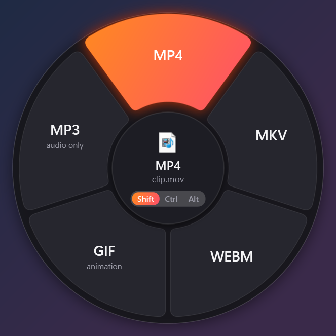
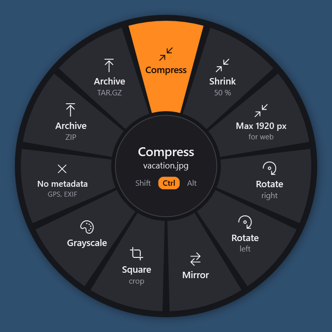
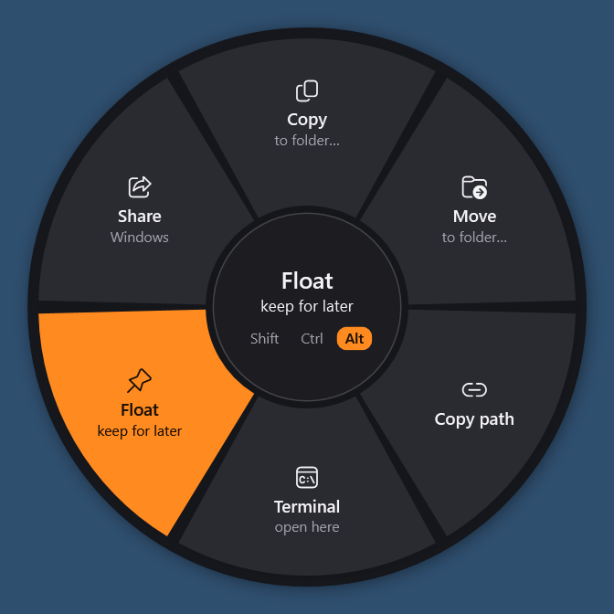
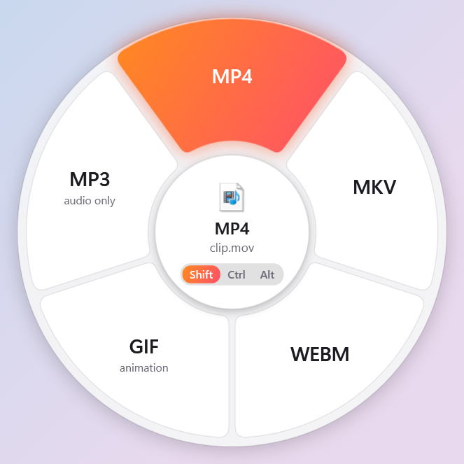
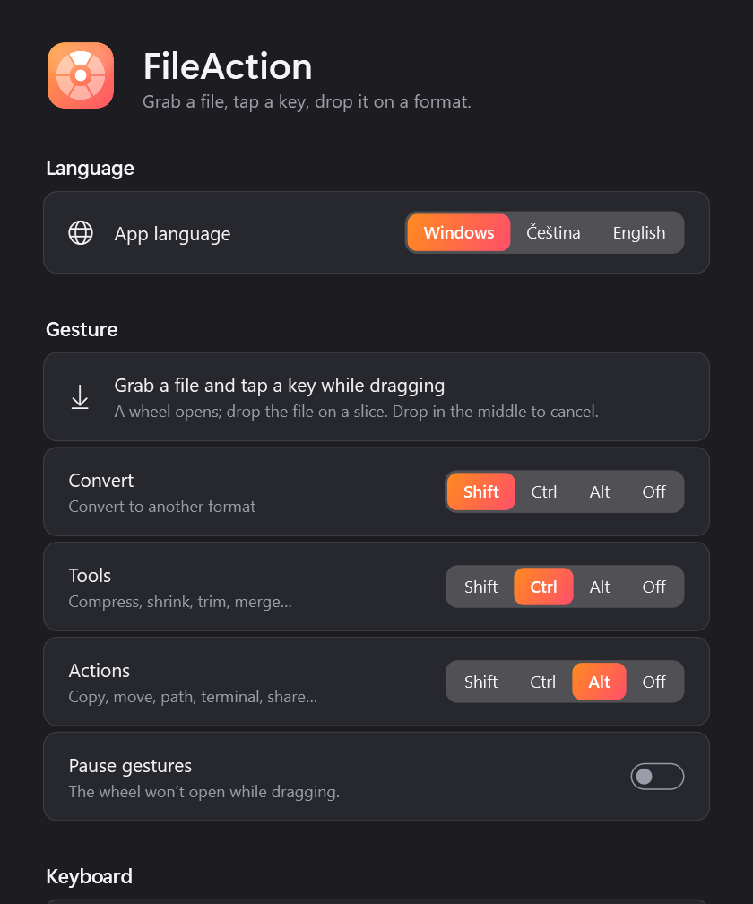
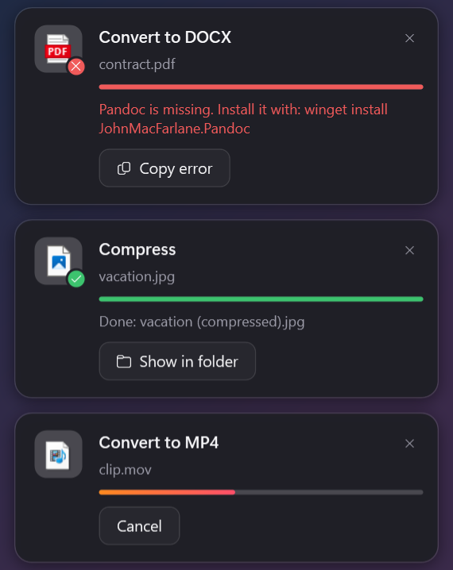

# FileAction

🇬🇧 **English** · 🇨🇿 [Čeština](README.cs.md)

**Click-free file conversion for Windows.** Grab a file, tap a key while dragging, and drop it on a format in a radial wheel. Everything runs locally; your files never leave your PC.

Inspired by the wonderful [Tangerine](https://tangerineformac.com/) for macOS. FileAction is an independent Windows take on the idea and is not affiliated with Tangerine.

<p align="center">
  
  
  
</p>
<p align="center">
  
  
  
</p>

## How it works

1. Grab a file: in File Explorer, on the desktop, an image or link in your browser, an e-mail attachment, a file inside a ZIP folder…
2. While dragging, **tap** a key:

   | Key | Wheel | What it offers |
   |---|---|---|
   | **Shift** | Convert | JPG, PNG, WebP, MP4, MP3, DOCX, PDF, XLSX… depending on the file type |
   | **Ctrl** | Tools | compress, shrink, rotate, trim, merge, split, archive… |
   | **Alt** | Actions | copy to…, move to…, copy path, terminal, floating shelf, share |

3. Drop the file on a slice. The result is saved next to the original (the original is never changed). Drop it in the middle of the wheel to cancel.

The wheel stays open until you drop, so you can release the key and tap another one to switch wheels. Keys can be reassigned in Settings.

**No mouse:** select files in File Explorer, or copy a file or a screenshot (**Win + Shift + S**), and press **Ctrl + Alt + Space**. Arrows pick a slice, Enter runs it, Tab switches wheels, Esc closes, 1–9 run a slice directly.
You can also open the wheel with **right-click → FileAction…** (on Windows 11 under “Show more options”).

Progress shows up in the corner of the screen, where you can open the result, show it in its folder or cancel.

## What it converts

| Type | From | To |
|---|---|---|
| Images | JPG, PNG, WebP, HEIC, TIFF, AVIF, BMP, GIF, ICO, SVG | JPG, PNG, WebP, AVIF, TIFF, ICO, PDF (GIF → MP4/WebM) |
| Audio | MP3, M4A, AAC, WAV, FLAC, OGG, Opus, AIFF, WMA | MP3, M4A, WAV, FLAC, OGG, Opus, AIFF |
| Video | MP4, MOV, MKV, WebM, AVI, WMV, FLV, MPG, 3GP, TS | MP4, MOV, MKV, WebM, GIF, MP3 |
| PDF | PDF | DOCX, JPG, PNG (all pages, 300 DPI), PPTX, TXT, MD, HTML, EPUB |
| Documents | DOCX, DOC, ODT, RTF, MD, TXT, HTML, EPUB | DOCX, PDF, ODT, MD, HTML, TXT, EPUB, RTF |
| Slides | PPTX, PPT, ODP | PDF, PNG, JPG (all slides), PPTX, ODP |
| Spreadsheets | XLSX, XLSM, XLS, ODS, CSV, TSV | XLSX, CSV, TSV, ODS, PDF |
| Subtitles | SRT, VTT | SRT, VTT, TXT |
| Archives | ZIP, TAR, TAR.GZ, GZ, BZ2, XZ, RAR, 7z | extract, ZIP, TAR, TAR.GZ |

**Tools (Ctrl):**
- images: compress, shrink to 50 %, max 1920 px, rotate, mirror, crop to square, grayscale, strip metadata (GPS, EXIF), merge into PDF,
- video: compress (H.264), 720p, mute, trim by time, rotate, 2× speed, thumbnail frame,
- audio: compress, normalize loudness, trim, join,
- PDF: merge, split into pages, rotate, optimize,
- images and scanned PDFs: **extract text (OCR)** with the recognizer built into Windows; the text is saved as .txt and copied to the clipboard,
- anything, folders included: archive to ZIP / TAR.GZ.

Things that aren't files yet (images dragged from a browser, Outlook attachments, screenshots on the clipboard) are saved to **Downloads\FileAction** first, and the results go next to them.

With several files selected, each one is converted separately; tools like “merge” produce a single result.

### Helper programs

FileAction handles images, PDFs, spreadsheets, subtitles and archives on its own. Some formats need extra programs:

- **FFmpeg** (audio and video) and **Pandoc** (documents) ship with the installer,
- **LibreOffice** (DOC, PPTX, ODS, documents and spreadsheets to PDF) has to be installed separately: `winget install TheDocumentFoundation.LibreOffice`.

**Settings → Helper programs** shows what is missing and can install it for you. The wheel only offers conversions whose tools are available.

## Install

Download `FileAction-Setup-x.y.z.exe` from [Releases](../../releases), or from the artifacts of the latest [GitHub Actions](../../actions) run. The installer doesn't need admin rights. A portable `.zip` is available too.

The app speaks English and Czech and comes in light and dark mode; both follow your Windows settings, and the language can be switched in Settings.

On first launch FileAction adds itself to startup and to the File Explorer context menu (both can be turned off in Settings). It then lives in the notification area next to the clock.

Requirements: Windows 10 (1809+) or Windows 11, x64.

## Build from source

```powershell
# .NET 10 SDK
./scripts/fetch-tools.ps1                      # downloads ffmpeg.exe and pandoc.exe into .\tools
dotnet test tests/FileAction.Tests             # conversion tests
dotnet publish src/FileAction.App -c Release -r win-x64 --self-contained -o publish
Copy-Item tools publish\tools -Recurse
publish\FileAction.exe
```

`FileAction.exe --self-test <folder>` builds every window offscreen and saves PNG previews in both languages (used by CI).

### Releasing

Push a commit to `main` whose message starts with `Release v1.2.3` (or push a `v1.2.3` tag, or run the **Build** workflow manually with a version). CI builds the installer and zip and publishes them as a GitHub release. Add a repository secret `RELEASE_TOKEN` (a fine-grained personal access token with *Contents: read and write* on this repository) to publish releases under your own account instead of github-actions.

## Project layout

```
src/FileAction.Core     conversions and tools (cross-platform library, also tested on Linux)
  Backends/             ImageMagick, FFmpeg, Pandoc, LibreOffice, PDF, spreadsheets, subtitles, archives
  Operations/Catalog.cs every slice on the Convert and Tools wheels
  Loc.cs                English / Czech strings
src/FileAction.App      the Windows app (WPF)
  Input/GlobalInput.cs  global mouse and keyboard hooks (the “drag + tap” gesture)
  Wheel/                the radial menu and when it opens
  Actions/              the Actions wheel, floating shelf, sharing
  Jobs/                 background jobs and progress cards
  Shell/                tray icon, hotkey, context menu, single instance
tests/FileAction.Tests  unit tests plus integration tests that run every operation on sample files
installer/              Inno Setup
```

## Differences from Tangerine

- Shift / Ctrl / Alt instead of Shift / Command / Control.
- Apple formats (Pages, Keynote, RTFD) and writing HEIC are not supported; HEIC can be opened.
- PDF → DOCX/EPUB/HTML converts the text, not the exact page layout (use PDF → PPTX or images for that).
- Tangerine's “AirDrop” action is **Share** on Windows (Nearby Sharing, Teams, Mail…).
